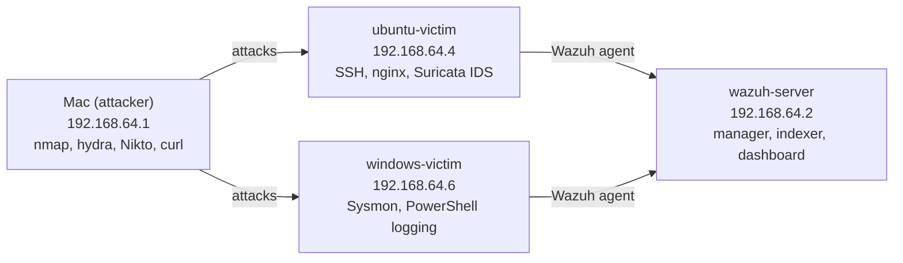

# SOC Home Lab – Wazuh SIEM

A home SOC lab I built to practise the work of a SOC analyst: collecting logs, running real attacks against my own machines, triaging the alerts in a SIEM, writing incident reports and tuning detections. Everything runs as virtual machines on one Apple Silicon Mac.

The lab contains 8 investigated incidents (including one false positive) and 3 custom Wazuh detection rules, each written from a gap I found during an investigation.

## Lab architecture



| Machine | OS | Role | Log sources |
| --- | --- | --- | --- |
| wazuh-server | Ubuntu Server 24.04 (ARM) | SIEM: Wazuh 4.14 manager, indexer, dashboard | – |
| ubuntu-victim | Ubuntu Server 24.04 (ARM) | Linux target | journald (SSH, sudo, user changes), Suricata eve.json, nginx access/error logs |
| windows-victim | Windows 11 Pro (ARM) | Windows target | Sysmon, PowerShell Script Block Logging (4104), Security log (4698 scheduled tasks) |
| Mac | macOS | Attacker | – |

## Tools

Wazuh 4.14 · Suricata (ET Open rules) · Sysmon · nginx · nmap · hydra · Nikto · curl · PowerShell · UTM

## Investigations

| ID | Incident | MITRE ATT&CK | Verdict |
| --- | --- | --- | --- |
| [INC-001](investigations/INC-001-ssh-nonexistent-user.md) | SSH login attempts for a non-existent user | T1110.001, T1021.004 | True positive (authorised test) |
| [INC-002](investigations/INC-002-ssh-brute-force-success.md) | SSH brute force followed by a successful login | T1110, T1078 | True positive, account compromised |
| [INC-003](investigations/INC-003-new-user-created.md) | New local user account created | T1136 | True positive (authorised admin action) |
| [INC-004](investigations/INC-004-nmap-port-scan.md) | Nmap port scan detected by Suricata | T1046 | True positive (authorised test) |
| [INC-005](investigations/INC-005-web-attack.md) | Manual web attacks and Nikto scan against nginx | T1190, T1595.002 | True positive, attack not successful |
| [INC-006](investigations/INC-006-false-positive-wazuh-sca.md) | PowerShell file creation by the Wazuh SCA scan | T1105 (as tagged) | False positive |
| [INC-007](investigations/INC-007-encoded-powershell.md) | Base64-encoded PowerShell running discovery commands | T1059.001 | True positive (authorised test) |
| [INC-008](investigations/INC-008-scheduled-task-persistence.md) | Scheduled task running hidden PowerShell as SYSTEM | T1053.005 | True positive (authorised test) |

Each report follows the same structure: summary, timeline, key alert evidence, investigation steps, analysis, verdict and tuning ideas.

## Custom detection rules

All rules are in [`rules/local_rules.xml`](rules/local_rules.xml). Each one has its own write-up with the test and before/after result.

| Rule | What it does | Based on | Before → after |
| --- | --- | --- | --- |
| [100100](rules/RULE-100100-hidden-scheduled-task.md) | Raises a scheduled task that starts PowerShell with a hidden window | INC-008 (60228) | level 4 → 12 |
| [100101 / 100102](rules/RULE-100102-port-scan.md) | Correlates 4+ Suricata ET SCAN alerts from one source IP within 60 s into one port scan alert | INC-004 (86601) | separate level 3 alerts → one level 10 alert |
| [100103](rules/RULE-100103-sca-false-positive.md) | Silences the PowerShell execution policy test file created during Wazuh SCA scans | INC-006 (92205) | level 9 → 0 (no alert) |

## Key findings

- **A SIEM can miss things.** In INC-002 the first brute-force run succeeded, but no success alert was generated. I only found the login by checking the victim's own logs. After enabling archiving, the second run was detected.
- **HTTP 200 does not mean the attack worked.** In INC-005 the "successful" attack responses were 615 bytes, the size of the normal homepage. The level 15 Shellshock alert was also overrated, because the server returned 404.
- **The same alert can mean different things.** Rule 92205 fired both for the Wazuh agent's own SCA scan (INC-006, false positive) and during a real persistence attack (INC-008). Context like the user, the parent process and the path decides the verdict.
- **Detection gaps exist after the first alert.** In INC-007 the encoded PowerShell was detected, but the discovery commands it ran (whoami, hostname) produced no alerts of their own.
- **Some detections need extra logging.** Scheduled task creation (4698) only appeared after I enabled the "Other Object Access Events" audit policy on Windows.
- **Tuning is a trade-off.** Silencing the INC-006 false positive (rule 100103) also silences the same file in INC-008. That attack is still caught by rule 100100, so the trade-off is acceptable.
- **Time sync matters.** The VMs' clocks drifted several times. Alerts were then stamped hours in the past and looked like missing data until I fixed time sync with chrony.

## Repository structure

```
soc-lab/
├── README.md
├── investigations/   incident reports INC-001 to INC-008
├── rules/            local_rules.xml and one write-up per custom rule
└── screenshots/      alert and rule-test screenshots used in the reports
```

## Notes

All attacks were run only against my own virtual machines on a private UTM network inside my Mac. No passwords, API keys or other secrets are stored in this repository.
