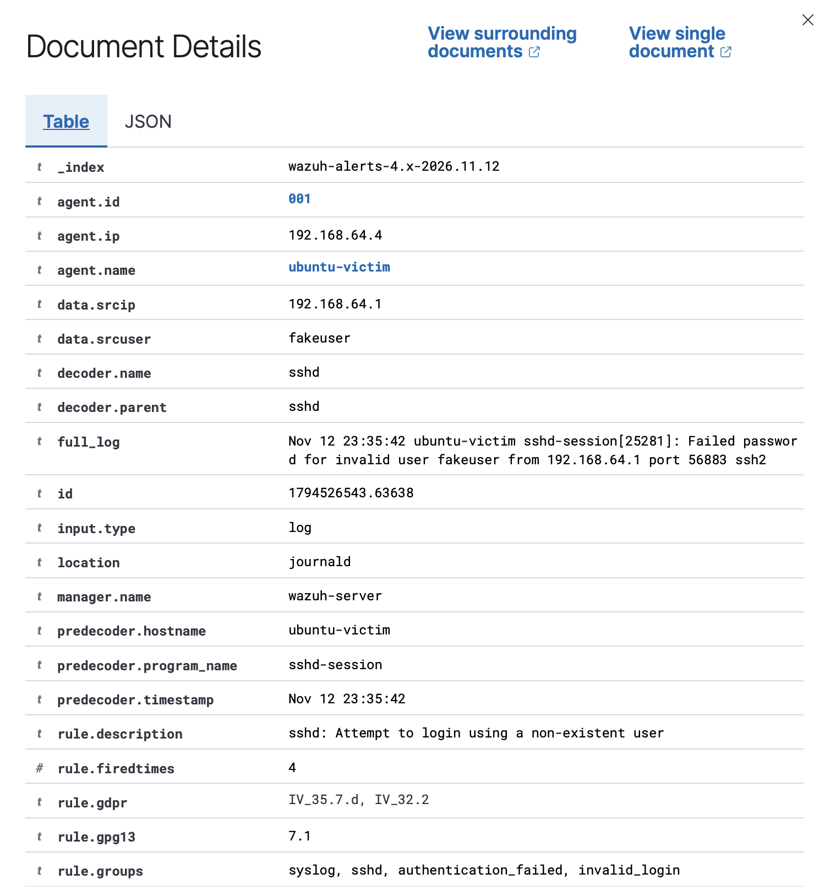

# INC-001: SSH login attempts for non-existent user

| Field | Value |
| --- | --- |
| Date / time | 2026-11-13 00:35 (UTC+1) |
| Agent (host) | ubuntu-victim (192.168.64.4) |
| Source IP | 192.168.64.1 |
| Rule ID / level | 5710 / 5 |
| MITRE ATT&CK | T1110.001 Password Guessing, T1021.004 SSH |
| Verdict | True positive, authorised test |

## Summary
Someone tried to log in over SSH to ubuntu-victim using username fakeuser, which does not exist. All attempts failed. The source was 192.168.64.1, which is my Mac on the lab network, so this was my own simulated attack.

## Evidence
Raw log line collected by the agent from journald:
```
Nov 12 23:35:42 ubuntu-victim sshd-session[25281]: Failed password for invalid user fakeuser from 192.168.64.1 port 56883 ssh2
```
Key alert fields:
```json
"rule": {
  "id": "5710",
  "level": 5,
  "description": "sshd: Attempt to login using a non-existent user",
  "firedtimes": 4,
  "groups": ["syslog", "sshd", "authentication_failed", "invalid_login"],
  "mitre": { "id": ["T1110.001", "T1021.004"] }
},
"data": { "srcip": "192.168.64.1", "srcuser": "fakeuser" },
"agent": { "name": "ubuntu-victim", "ip": "192.168.64.4" }
```


The alert shows the source IP, the username that was tried, and the original log line. `firedtimes: 4` means this rule fired four times in this burst, which matches the four failed attempts I made.

## Analysis
- The username does not exist, so the attacker was guessing usernames, not using a known account.
- Only four attempts in a short time, all failed. This looks like manual guessing, not an automated brute-force tool.
- No successful login from 192.168.64.1 was found for this period.
- Wazuh maps this to Credential Access (T1110.001, password guessing) and to SSH as a remote service (T1021.004).

## Response
In a real environment I would:

1. Check for any successful login from 192.168.64.1 (`sshd: authentication success`) before and after these attempts.
2. Find out who owns the source IP. If it is unknown or external, block it at the firewall.
3. If the attempts continue, escalate to a brute-force investigation.
4. Close as a true positive with no compromise if nothing else is found.

Here the source is my own Mac running a planned test, so no action is needed.

## Tuning
One failed login for a non-existent user is very common on any server reachable from the internet, so level 5 is reasonable and should not page anyone on its own. The more useful signal is many of these from one IP in a short time (Wazuh's brute-force rule 5712), or any successful login straight after them. That second case is one of my planned custom rules.

## Compliance mapping (from Wazuh)

PCI DSS 10.2.4, 10.2.5, 10.6.1 · NIST 800-53 AC-7, AU-6, AU-14 · HIPAA 164.312.b · GDPR IV_35.7.d, IV_32.2
