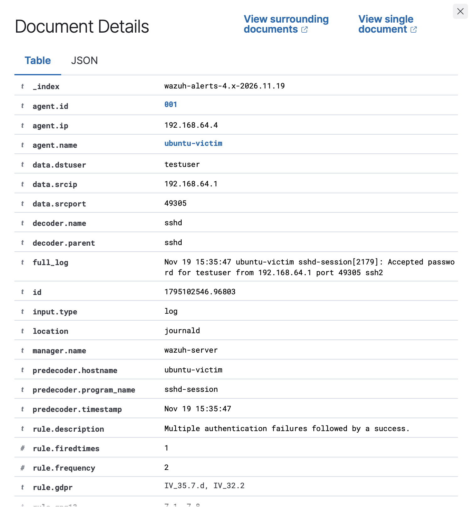

# INC-002: SSH brute force followed by successful login

| Field | Value |
| --- | --- |
| Date / time | 2026-11-19, 15:35:36 – 15:35:47 UTC |
| Agent (host) | ubuntu-victim (192.168.64.4) |
| Source IP | 192.168.64.1 |
| Target user | testuser |
| Main rule ID / level | 40112/12 |
| MITRE ATT&CK | T1078 Valid Accounts, T1110 Brute Force |
| Verdict | True positive, account compromised |


## Summary
192.168.64.1 tried to gain access to a testuser account using SSH brute force. The connection was successful and attacker gained access to the account.

## Timeline
| Time (UTC) | Rule ID | Level | What happened |
| --- | --- | --- | --- |
| 15:35:36 | 5557 | 5 | First password check failed |
| 15:35:43 | 5763 | 10  | Authentication failed, brute force detected |
| 15:35:47 | 2502 | 10 | User missed the password more than one time |
| 15:35:47 | 40112 | 12 | Multiple authentication failures followed by a success |

## Evidence
Key alert:

```json
"rule": {
  "id": "40112",
  "level": 12,
  "description": "Multiple authentication failures followed by a success.",
  "groups": ["syslog", "attacks"],
  "mail": true,
  "mitre": {
    "id": ["T1078", "T1110"],
    "technique": ["Valid Accounts", "Brute Force"]
  }
},
"data": { "srcip": "192.168.64.1", "srcport": "49305", "dstuser": "testuser" },
"agent": { "name": "ubuntu-victim", "ip": "192.168.64.4" },
"full_log": "Nov 19 15:35:47 ubuntu-victim sshd-session[2179]: Accepted password for testuser from 192.168.64.1 port 49305 ssh2",
"timestamp": "2026-11-19T15:35:46.542+0000"
```

Raw log line from the host:

```
Nov 19 15:35:47 ubuntu-victim sshd-session[2179]: Accepted password for testuser from 192.168.64.1 port 49305 ssh2
```




The evidence contains rule 40112 (level 12) which reports brute force attack that succeeded. `data.srcip` shows 192.168.64.1 and `full_log` contains 'Accepted password for testuser'. The successful login came from port 49305, the same source port used by the previously failed attempts.
14 failed attempts were counted using the command:
```
sudo journalctl --since "2026-11-19 15:35:00" --until "2026-11-19 15:36:30" | grep -c "Failed password for testuser"
```


## Analysis
- The attack was automated since the timestamp proves that 14 attempts were conducted in a period of about 10 seconds from one IP address.
- It took only 14 attempts to succeed which indicated that the password is weak.
- The noise: 52002 AppArmor DENIED (comes from the who command on each login), duplicate alerts (each wrong password creates three alerts)

## Response
In a real environment I would:

1. Lock the account and reset the password 
2. Forbid found IP address connecting to the service through firewall
3. Enforce a password policy, disable password login and use SSH keys
4. Check whether the same IP address attacked other machines

## Detection gap: first run 
- What happened: The first attack run was a false negative since no success alert 40112 was generated although the brute-force alert 5763 did fire.
- How I checked: I checked the victim's log with `journalctl` (showed `Accepted password for testuser` at 15:12:33). `wazuh-logtest` matched that line to rule 5715, so the rule exists. However, the grep on `alerts.log` found no alert.
- Root cause: Cause not confirmed. The successful login was confirmed on the host, however the alert was not generated. This could not be verified because event archiving was disabled during the first run.
- What I changed: I enabled archiving and repeated the attack. In the second run, detection worked and rule 40112 fired.
- Lesson: Wazuh is not the only source that should be used for analysis. Sometimes additional investigation can help resolve problems if the SIEM is silent.

## Tuning
- AppArmor noise: 52002 fires on every login → suppress that who case.
- Duplicates: 3 alerts per wrong password → count from one source (5760).
- No automatic response: attacker got in 5 seconds after 5763 → Active Response blocks the IP.
- Detection gap: first-run success missed → keep archiving on and monitor agents.


