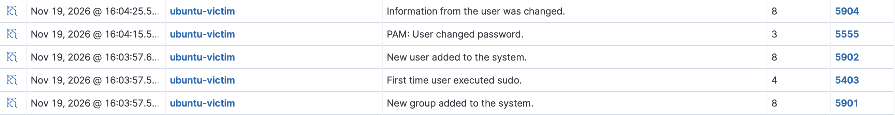

# INC-003: New user account created (authorised)

| Field | Value |
| --- | --- |
| Date / time | Nov 19, 2026 16:03:57 (UTC+1) |
| Agent (host) | ubuntu-victim (192.168.64.4) |
| Performed by | dianatar |
| New account | testuser |
| Main rule ID / level | 5902/8 |
| MITRE ATT&CK | T1136 Create Account |
| Verdict | True Positive (authorised admin action) |

## Summary
A creation of new user was detected with Rule 5902 Level 8. The alert is true positive since it was correct, but the activity came from dianatar (root permissions).

## Timeline
| Time (UTC) | Rule ID | Level | What happened |
| --- | --- | --- | --- |
| Nov 19 15:03:57 | 5901 | 8 | New group added to the system |
| Nov 19 15:03:57 | 5403 | 4 | First time user executed sudo |
| Nov 19 15:03:57 | 5902 | 8 | New user added to the system |
| Nov 19 15:04:14 | 5555 | 3 | User changed password |
| Nov 19 15:04:25 | 5904 | 8 | Information from the user was changed |

## Evidence
Key alert (new user):

```json
"rule": {
  "id": "5902",
  "level": 8,
  "description": "New user added to the system.",
  "mitre": {
    "id": ["T1136"],
    "technique": ["Create Account"],
    "tactic": ["Persistence"]
  }
},
"data": { "dstuser": "testuser", "uid": "1001", "home": "/home/testuser", "shell": "/bin/bash" },
"agent": { "name": "ubuntu-victim", "ip": "192.168.64.4" },
"full_log": "Nov 19 15:03:57 ubuntu-victim useradd[1761]: new user: name=testuser, UID=1001, GID=1001, home=/home/testuser, shell=/bin/bash, from=/dev/pts/0",
"timestamp": "2026-11-19T15:03:57.632+0000"
```

Related alert (who did it):

```json
"rule": {
  "id": "5403",
  "level": 4,
  "description": "First time user executed sudo.",
  "mitre": {
    "id": ["T1548.003"],
    "technique": ["Sudo and Sudo Caching"]
  }
},
"data": { "srcuser": "dianatar", "dstuser": "root", "tty": "/dev/tty1", "command": "/usr/sbin/adduser testuser" },
"full_log": "Nov 19 15:03:57 ubuntu-victim sudo[1748]: dianatar : TTY=/dev/tty1 ; PWD=/home/dianatar ; USER=root ; COMMAND=/usr/sbin/adduser testuser",
"timestamp": "2026-11-19T15:03:57.589+0000"
```



Alerts about adding a new user came at the same time and 5403 shows that the command `/usr/sbin/adduser testuser` was used.

## Analysis
- New account's permissions are UID=1001, GID=1001, 100(users) confirmed with command `id testuser`.
- Account was created by admin account dianatar using sudo, which is confirmed by alert rule 5403.
- In a case with attacker it would be severely dangerous if such alert was missed, since a hidden account is a backdoor and even after fixing initial sport an attacker can log into created account again.

## Verdict
This is an authorised action confirmed by inspecting alerts and confirming that it was done by Dianatar with sudo (also done from the local console tty) and the account is a normal user. In a real environment I would ask the admin or check for an approved change. 

## Response
In this case only confirmation that the action is legal needed which was done in this report.

## Tuning
Every new user created gets level 8, without distinguishing whether it is regular user or admin. Therefore, I would suggest adding a higher level when a new user is added to the sudo group.
