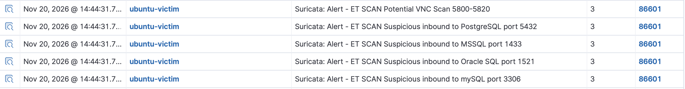

# INC-004: Nmap port scan detected by Suricata
| Field | Value |
| --- | --- |
| Date / time | 2026-11-20 14:43:16 (UTC+1)|
| Agent (host) | ubuntu-victim (192.168.64.4) |
| Source IP | 192.168.64.1 |
| Detected by | Suricata |
| Main rule ID / level | 86601 / 3 |
| MITRE ATT&CK | T1046 Network Service Discovery |
| Verdict | True positive (authorised test) |

## Summary
5 simultaneous alerts raised by Suricata about traffic that looks like scanning (SCAN) coming into protected network from 192.168.64.1. Only port 22 is open.
## Timeline
| Time (UTC+1) | Source | What happened |
| --- | --- | --- |
| 14:43 | Nmap | Nmap scan report for 192.168.64.4|
| 14:43:16 | Suricata | First Suricata alerted about suspicious inbound to database through port 3306|
| 14:43:16 | Suricata | Last Suricate alert about Potential VNC Scan 5800-5820|


## Evidence
Key alert:

```json
"rule": {
  "id": "86601",
  "level": 3,
  "description": "Suricata: Alert - ET SCAN Suspicious inbound to MSSQL port 1433",
  "groups": ["ids", "suricata"]
},
"data": {
  "src_ip": "192.168.64.1",
  "src_port": "52292",
  "dest_ip": "192.168.64.4",
  "dest_port": "1433",
  "proto": "TCP",
  "alert": {
    "signature": "ET SCAN Suspicious inbound to MSSQL port 1433",
    "signature_id": "2010935",
    "category": "Potentially Bad Traffic",
    "action": "allowed"
  },
  "flow": {
    "pkts_toserver": "1",
    "bytes_toserver": "58",
    "bytes_toclient": "0"
  },
  "timestamp": "2026-11-20T13:43:16.162524+0000"
},
"agent": { "name": "ubuntu-victim", "ip": "192.168.64.4" },
"location": "/var/log/suricata/eve.json"
```
nmap command:
`sudo nmap -sS -sV 192.168.64.4`
Attacker's view (nmap output):

```
Nmap scan report for 192.168.64.4
Host is up (0.00031s latency).
Not shown: 999 closed tcp ports (reset)
PORT   STATE SERVICE VERSION
22/tcp open  ssh     OpenSSH 10.2p1 Ubuntu 2ubuntu3.8 (Ubuntu Linux; protocol 2.0)
MAC Address: 86:85:F0:05:0C:1F (Unknown)
Service Info: OS: Linux; CPE: cpe:/o:linux:linux_kernele
```



Several 86601 with Level 3 alerts that arrived from the same IP address that suspiciously look like a scan.

## Analysis
- Together alerts informs that one IP address is trying to check access to target's databases in a second, meaning that the process is automated.
- Only service on port 22 is open. Nmap scanned 1000 ports, however Suricate raised only 5 alerts which means that the alerts understate how big the scan was. 
- Nothing was blocked because Suricata runs as IDS so it detects but doesn't block.

## Response
In a real environment I would:

1. Confirm that the event was automated scanning by analysing logs.
2. Check whether the scanning was planned or came from unauthorised IP address.
3. If the scanning was unauthorised block the traffic from that IP address and report the attempt.

## Tuning
The rule assigned to the alert was not accurate and says that it is only Level 3 although scanning can lead to attacks. I would suggest raising the severity for several ET SCAN alerts coming from the same address within short period of time.
