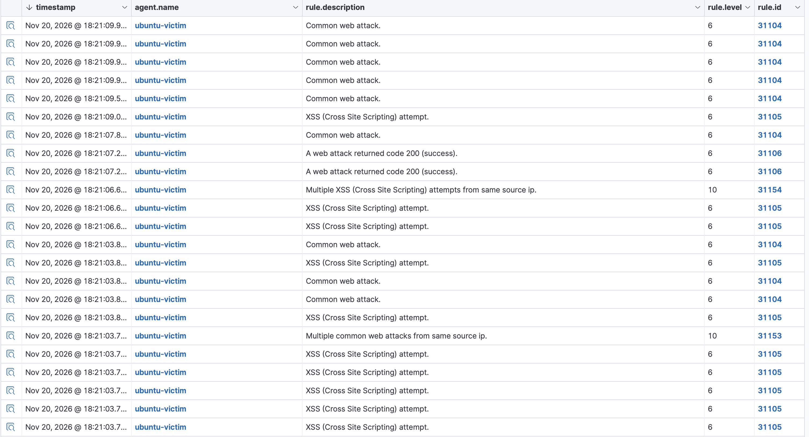

# INC-005: Web attacks analysis

| Field | Value |
| --- | --- |
| Date / time | Nov 20, 2026 18:20:30 UTC+1 |
| Agent (host) | ubuntu-victim 192.168.64.4 |
| Source IP | 192.168.64.1 |
| Tools used by attacker | Manual, Nikto |
| Main rule ID / level | 31106 / 6 (manual), 31168 / 15 (scan) |
| MITRE ATT&CK | T1190 Exploit Public-Facing Application, T1595.002 Vulnerability Scanning |
| Verdict | True Positive |

## Summary
An attack consists of manual attack using curl commands exploiting SQL injection, web attacks (path traversal, XSS). Manual attack are followed by a number of automated attempts from a scanner.

## Timeline
| Time (UTC+1) | Source | What happened |
| --- | --- | --- |
| 18:20:30 | 192.168.64.1, manual | SQL injection attempt |
| 18:20:30 | 192.168.64.1, manual| A web attack returned code 200 (success) |
| 18:20:52 | scanner | First Shellshock attack detected |
| 18:21:09 | scanner | Last automated attack |


## Evidence
Manual attacks (curl):

| Attack | Request | Rule | Level |
| --- | --- | --- | --- |
| SQL injection | GET /?id=1%27%20OR%20%271%27=%271 | 31164  | 6 |
| Path traversal | GET /?file=../../../../etc/passwd | 31106 | 6 |
| XSS | GET /?q=%3Cscript%3Ealert(1)%3C/script%3Ec | 31106 | 6 |

Key alert:

```json
"rule": {
  "id": "31106",
  "level": 6,
  "description": "A web attack returned code 200 (success).",
  "mitre": { "id": ["T1190"], "technique": ["Exploit Public-Facing Application"] }
},
"data": { "srcip": "192.168.64.1", "url": "/?file=../../../../etc/passwd", "id": "200" },
"agent": { "name": "ubuntu-victim", "ip": "192.168.64.4" },
"full_log": "192.168.64.1 - - [20/Nov/2026:17:20:29 +0000] \"GET /?file=../../../../etc/passwd HTTP/1.1\" 200 615 \"-\" \"curl/8.7.1\""
```

The manual track was performed using curl command for all of the manual attempts.

Automated scan (Nikto), alerts by rule:

| Rule | Description | Level | Count |
| --- | --- | --- | --- |
| 31168 | Shellshock attack detected | 15 | 2 |
| 31104 | Common web attack | 6 | 43 |
| 31153 | Multiple common web attacks from same source ip | 10 | 21 |
| 31154 | Multiple XSS (Cross Site Scripting) attempts from same source ip | 10 | 22 |
| 31103 | SQL injection attempt | 7 | 4 |




A huge number of alerts are raised from scanning attempt searching for vulnerabilities. Multiple simultaneous attempts get Level 10.

## Analysis
- For manual attempt alerts inform us that a web attack turned code 200 (success), but while inspecting the json it turns out that the response weights 615 bytes which corresponds to a regular page. Therefore the attack did not succeed. Most scanner requests returned 404; the few 200 responses were the normal homepage (615 bytes). 
- Manual requests contain curl commands from User-Agent which is done manually and takes only three attempts, whereas automates sends hundreds of requests simultaneously.
- Alert 31168 (Level 15) is the most severe alert that informs about shellshock attack detection, but it returned 404 because the server returned no CGI scripts (/banner.cgi doesn’t exist), however its severity is dramatic.

## Response
In a real environment I would:

1. Inspect the logs carefully for successful attempt.
2. Block the traffic from that source fully.
3. If success found, investigate the issue and mitigate it.

## Tuning
A lot of alerts such as Rule 31151 alert (Multiple web server 400 error codes from same source ip) or Rule 31101 (Web server 400 error code) since they create noise, therefore I would stop their re-fire on every request. In addition, I would lower severity of Rule 31168 (Shellshock attack detected) in a case it return 404. 
