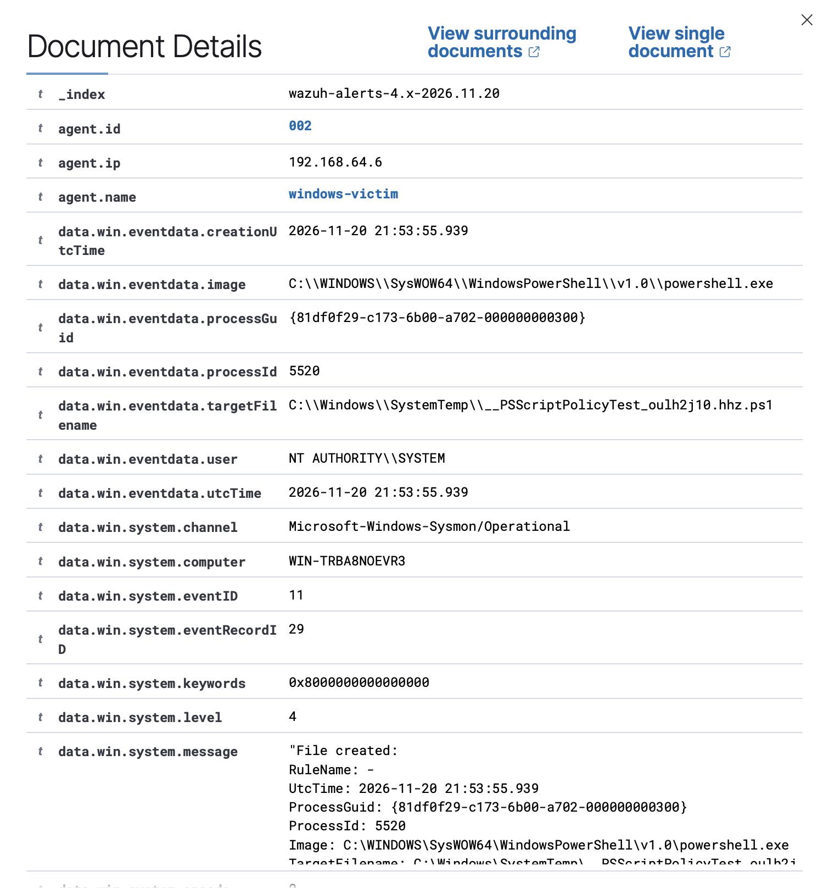

# INC-006: False Positive Windows Alert

| Field | Value |
| --- | --- |
| Date / time | Nov 20, 2026 22:53:47 |
| Agent (host) | windows-victim 192.168.64.6|
| Process / user | NT AUTHORITY\\SYSTEM |
| Main rule ID / level | 92205 / 9 |
| MITRE ATT&CK (as tagged by Wazuh) | T1105 Ingress Tool Transfer |
| Verdict | False Positive |

## Summary
The activity ran as SYSTEM from the Wazuh agent’s folder and only read the password history setting, which is consistent with the Wazuh agent’s routine security configuration check (SCA). No malicious activity was found.

## Timeline
| Time (UTC+1) | Rule ID | Level | What happened |
| --- | --- | --- | --- |
| 22:53:47 | 92205 | 9 | First Powershell process created an executable file in Windows root folder |
| 22:53:49 | --- | --- | PowerShell (SYSTEM) starts SecEdit.exe to export security settings |
| 22:53:56 | 92205 | 9 | Last Powershell process created an executable file in Windows root folder |


## Evidence

Key alert:

```json
"rule": { "id": "92205", "level": 9, "description": "Powershell process created an executable file in Windows root folder", "mitre": { "id": ["T1105"] } },
"data": { "win": { "eventdata": {
  "image": "C:\\WINDOWS\\SysWOW64\\WindowsPowerShell\\v1.0\\powershell.exe",
  "targetFilename": "C:\\Windows\\SystemTemp\\__PSScriptPolicyTest_cekabyy2.awu.ps1",
  "user": "NT AUTHORITY\\SYSTEM",
  "processGuid": "{81df0f29-c16a-6b00-9e02-000000000300}"
} } }
```



## Investigation
What I checked and how:

```powershell
Get-WinEvent -FilterHashtable @{LogName='Microsoft-Windows-Sysmon/Operational'; Id=1} | Where-Object { $_.Message -like '*81df0f29-c16a-6b00-9e02-000000000300*' } | Select-Object -First 1 -ExpandProperty Message
```

Key lines from the output:

```
Process Create:
UtcTime: 2026-11-20 21:53:49.144
ProcessGuid: {81df0f29-c16d-6b00-a302-000000000300}
ProcessId: 4460
Image: C:\Windows\SysWOW64\SecEdit.exe
Description: Windows Security Configuration Editor Command Tool
Company: Microsoft Corporation
CommandLine: "C:\WINDOWS\system32\SecEdit.exe" /export /cfg C:\WINDOWS\TEMP\secpol.cfg
CurrentDirectory: C:\Program Files (x86)\ossec-agent\
User: NT AUTHORITY\SYSTEM
ParentProcessGuid: {81df0f29-c16a-6b00-9e02-000000000300}
ParentProcessId: 7216
ParentImage: C:\Windows\SysWOW64\WindowsPowerShell\v1.0\powershell.exe
ParentCommandLine: powershell secedit /export /cfg $env:TEMP\secpol.cfg; Get-Content $env:TEMP\secpol.cfg | Select-String "PasswordHistorySize"; Remove-Item $env:TEMP\secpol.cfg
ParentUser: NT AUTHORITY\SYSTEM
```

After analysing alert 92205 with severity 9 I extracted processGuid and looked for data about that particular process using the power shell command displayed above. the PowerShell was run by the system from the Wazuh agent’s folder, only to read one password setting. That’s consistent with the agent’s routine security check (SCA), so it’s a false positive.

## Analysis
- A background service ran it since NT AUTHORITY\SYSTEM is a background service. Also the directory is Wazuh agents directory that confirms that the Wazuh ran it.
- It exported the security settings, read only PasswordHistorySize, then deleted the temp file
- Creating a file in root folder and deleting something looks suspicious and should be investigated.

## Verdict
This is false positive since the source and event is confirmed and comes from legitimate source.

## Tuning
I would lower 92205 when the PowerShell runs as SYSTEM from the Wazuh agent’s folder.
