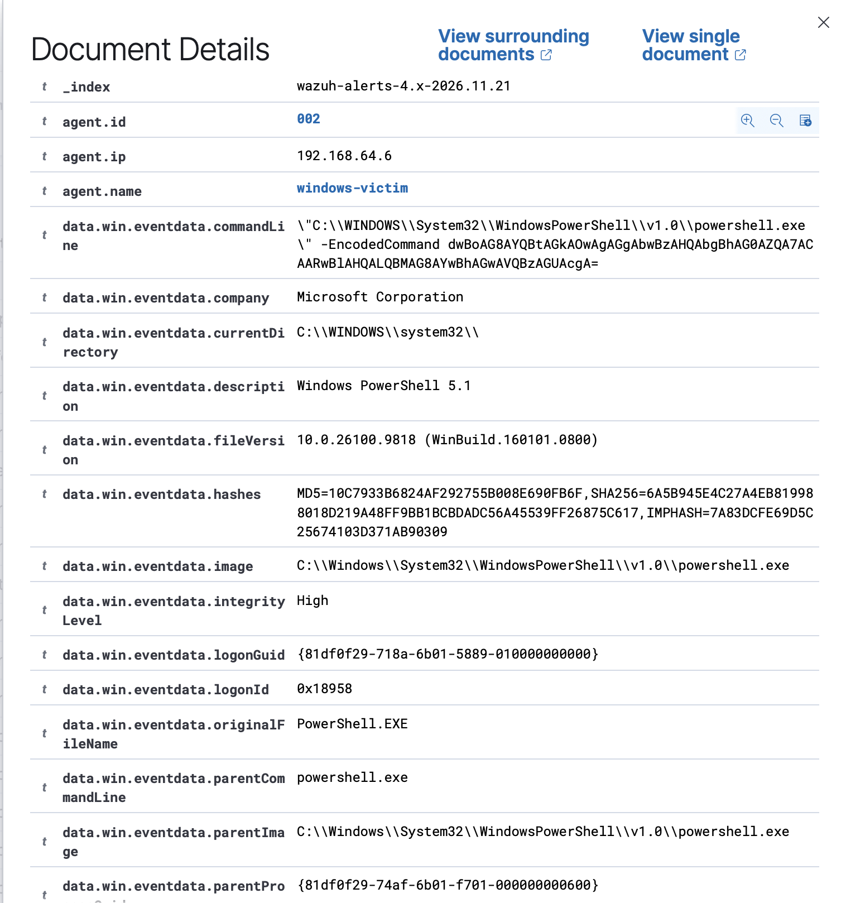

# INC-007: Encoded command

| Field | Value |
| --- | --- |
| Date / time | Nov 21, 2026  11:44:11 (UTC+1) |
| Agent (host) | windows-victim 192.168.64.6 |
| User | WIN-TRBA8NOEVR3\\dianatar |
| Privileges | High  (administrator) |
| Main rule ID / level | 92057 / 12 |
| MITRE ATT&CK | T1059.001 PowerShell |
| Verdict | True Positive (authorised test) |

## Summary
An encoded command was executed from account with high privileges that after decoding reveal commands such as: whoami, hostname, Get-LocalUser detected by Rule 92057 with Level 12.

## Timeline
| Time (UTC+1) | Rule ID | Level | What happened |
| --- | --- | --- | --- |
| 11:44:11 | 92057 | 12 | Powershell.exe spawned a powershell process which executed a base64 encoded command |
| 11:44 | | | hidden PowerShell runs whoami.exe / hostname.exe (Sysmon only, no alert) |
| ~12:05 | --- | --- | analyst decodes the Base64 during the investigation |

## Evidence
Key alert:

```json
"rule": {
  "id": "92057",
  "level": 12,
  "description": "Powershell.exe spawned a powershell process which executed a base64 encoded command",
  "mitre": { "id": ["T1059.001"], "technique": ["PowerShell"], "tactic": ["Execution"] }
},
"data": { "win": { "eventdata": {
  "commandLine": "powershell.exe -EncodedCommand dwBoAG8AYQBtAGkAOwAgAGgAbwBzAHQAbgBhAG0AZQA7ACAARwBlAHQALQBMAG8AYwBhAGwAVQBzAGUAcgA=",
  "parentImage": "C:\\Windows\\System32\\WindowsPowerShell\\v1.0\\powershell.exe",
  "parentProcessId": "6804",
  "user": "WIN-TRBA8NOEVR3\\dianatar",
  "integrityLevel": "High",
  "utcTime": "2026-11-21 10:44:09.784"
} } },
"agent": { "name": "windows-victim", "ip": "192.168.64.6" }
```



PowerShell execution started by a user dianatar (high privileges) with encoded command that alerted Rule 92057 Level 12 that requires investigation.

## Investigation
Decoding the hidden command:

```powershell
[System.Text.Encoding]::Unicode.GetString([Convert]::FromBase64String('dwBoAG8AYQBtAGkAOwAgAGgAbwBzAHQAbgBhAG0AZQA7ACAARwBlAHQALQBMAG8AYwBhAGwAVQBzAGUAcgA='))
```

Result:

```
whoami; hostname; Get-LocalUser
```
Attacker was trying to execute PowerShell and hide the contents of the commands and extract system information about windows-victim.

## Analysis
- User dianatar ran commands with high user privileges.
- Hidden command asked for system information which is what usually attackers do in order to gather information.whoami = current user, hostname = computer name, Get-LocalUser = all local accounts.
- Encoded command can pass security checks and hide compromising data or can be missed by someone since it looks like gibberish.

## Response
In a real environment I would:

1. Analyse the command executed and report it.
2. Investigate whether the user is legit.
3. If not, I would block access to the server for that user.

## Tuning
The encoded PowerShell was detected (92057), but the discovery commands it ran (whoami, hostname) produced no alerts of their own. I would suggest adding a rule for discovering commands started by encoded PowerShell.
