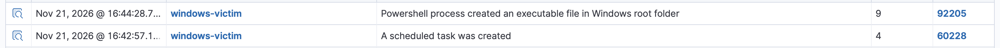

# INC-008: Scheduled task analysis 

| Field | Value |
| --- | --- |
| Date / time | Nov 21, 2026 16:42:57 (UTC+1) |
| Agent (host) | windows-victim 192.168.64.6 |
| Created by | user dianatar |
| Task name | WindowsUpdateCheck |
| Runs as | SYSTEM |
| Main rule ID / level | 60228 / 4|
| MITRE ATT&CK | T1053.005 Scheduled Task |
| Verdict | True Positive (Authorised test) |

## Summary
A hidden scheduled task created by a user dianatar (admin) that executes PowerShell command as SYSTEM on every login and writes it to the file.

## Timeline
| Time (UTC+1) | Rule ID | Level | What happened |
| --- | --- | --- | --- |
| 16:42:57 | 60228 | 4 | A scheduled task was created |
| 16:44:28 | 92205 | 9 | The task runs: a SYSTEM PowerShell starts |

## Evidence
Key alert:

```json
"rule": { "id": "60228", "level": 4, "description": "A scheduled task was created", "mitre": { "id": ["T1053"], "tactic": ["Execution", "Persistence", "Privilege Escalation"] } },
"data": { "win": {
  "eventdata": {
    "subjectUserName": "dianatar",
    "taskName": "\\WindowsUpdateCheck",
    "parentProcessId": "7544"
  },
  "system": { "eventID": "4698", "channel": "Security", "systemTime": "2026-11-21T15:42:55.9758053Z" }
} },
"agent": { "name": "windows-victim", "ip": "192.168.64.6" }
```

Task definition (from the alert):

```xml
<Triggers><LogonTrigger><Enabled>true</Enabled></LogonTrigger></Triggers>
<Exec>
  <Command>powershell.exe</Command>
  <Arguments>-WindowStyle Hidden -Command whoami &gt; C:\Users\Public\update.txt</Arguments>
</Exec>
<Principal><UserId>S-1-5-18</UserId></Principal>
```



A schedules task was created hiding and disguising itself as WindowsUpdateCheck execution whoami command that is afterwards is written to a file.

## Analysis
- The main suspicion is that the processes has fake Windows name created by a user in root directory. In addition, scheduled task window gets hidden.
- After each login it would execute the command and write the contents of respond to a file.
- It extracts system information like in INC-007 (both attempts have the same session logon Id), however this time it allows the attacker to stay in the system after login.
- Current alert is different from INC-006 because here it is manual True Positive attack whereas in INC-006 the event was triggered by system itself creating and deleting files to check system rules.

## Response
In a real environment I would:
1. Investigate how a session started
2. Isolate a compromised environment if the attack is confirmed and reset password. 
3. Preserve evidence before deleting anything
4. Delete the original task and all of the files associated to it.

## Clean-up
Scheduled task is removed along with the file that was created by it: update txt using command.

```powershell
schtasks /delete /tn "WindowsUpdateCheck" /f
del C:\Users\Public\update.txt
```

## Tuning
I would suggest raising severity for such incidents since it includes enough red-flags for higher number than 4. Scheduled task is a great opportunity for attacker to stay in the system so it is a serious security exploit.
