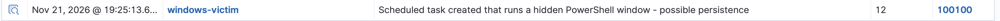

# RULE-100100: RULE-100100: Hidden PowerShell in a scheduled task

| Field | Value |
| --- | --- |
| Rule ID / level | 100100 / 12 |
| Based on | 60228 (A scheduled task was created) |
| Found in | INC-008 |
| MITRE ATT&CK | T1053.005 Scheduled Task, T1564.003 Hidden Window |

## Problem
The rule helps detect a malicious creation of scheduled tasks that can help an attacker get access to the system again at every login. In INC-008 Rule 60228 Level 4 was assigned to such case which can be a reason for missing such an event.

## Rule

```xml
<group name="local,windows,persistence,">
  <rule id="100100" level="12">
    <if_sid>60228</if_sid>
    <field name="win.eventdata.taskContent" type="pcre2">(?i)WindowStyle\s+Hidden</field>
    <description>Scheduled task created that runs a hidden PowerShell window - possible persistence</description>
    <mitre>
      <id>T1053.005</id>
      <id>T1564.003</id>
    </mitre>
  </rule>
</group>
```

The rule looks for creation of scheduled tasks that run in a hidden window using WindowStyle Hidden parameters and assigns such even Level 12 instead of usual 4.

## Test
How I tested it:

```powershell
schtasks /create /tn "WindowsUpdateCheck" /tr "powershell.exe -WindowStyle Hidden -Command whoami > C:\Users\Public\update.txt" /sc onlogon /ru SYSTEM /f
```

## Result

| | Before | After |
| --- | --- | --- |
| Rule ID | 60228 | 100100 |
| Level | 4 | 12 |
| Description | A scheduled task was created | Scheduled task created that runs a hidden PowerShell window - possible persistence |



## Limits
- This rule can miss other forms of commands: PowerShell also accepts -w hidden, -win h or -WindowStyle 1. If the attacker's task runs something other than a hidden PowerShell (e.g. a .bat or .vbs file), the rule won't fire.
- Some updaters or admin scripts also create tasks with hidden PowerShell windows. They'd get a level 12 alert too, and an analyst would have to check them.
