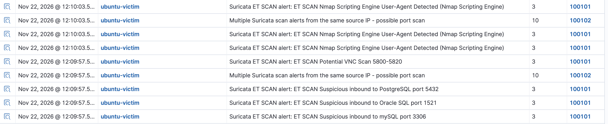

# RULE-100102: Port scan rule detection

| Field | Value |
| --- | --- |
| Rule ID / level | 100101 / 3, 100102 / 10 |
| Based on | 86601, the Suricata alert rule |
| Found in | INC-004, the nmap port scan |
| MITRE ATT&CK | T1046, Network Service Discovery |

## Problem
Rule 86601 only handles each Suricata alert on its own, but does not see the pattern of multiple scan alerts from one IP address which was investigated in INC-004 with Nmap scan. Each alert is Level 3 which make is easy to miss it.

## Rule

```xml
<group name="local,ids,suricata,scan,">
  <rule id="100101" level="3">
    <if_sid>86601</if_sid>
    <field name="alert.signature" type="pcre2">^ET SCAN</field>
    <description>Suricata ET SCAN alert: $(alert.signature)</description>
  </rule>

  <rule id="100102" level="10" frequency="4" timeframe="60">
    <if_matched_sid>100101</if_matched_sid>
    <same_field>src_ip</same_field>
    <description>Multiple Suricata scan alerts from the same source IP - possible port scan</description>
    <mitre>
      <id>T1046</id>
    </mitre>
  </rule>
</group>
```

This group has two rules: 100101 catches all of the Suricata alerts whose signature starts with ET SCAN while 100102 is raised when 4 alerts from the same source IP within 60 seconds are raised with Level 10 instead of 3.

## Test
How I tested it:

```bash
sudo nmap -sS -sV 192.168.64.4
```

## Result

| | Before | After |
| --- | --- | --- |
| Rule ID | 86601 | 100101 + 100102 |
| Level | 3 | 10 + 3 |
| Description | Suricata: Alert - ET SCAN … | Suricata ET SCAN alert: ET SCAN … / Multiple Suricata scan alerts from the same source IP - possible port scan |



## Limits
- This rule can miss a slow scan which is scheduled to send fewer than 4 requests within 60 seconds. Anything Suricata flags as not ET SCAN - it occurs quite often that it can be missed.
- Legitimate scanners can trigger this alert.
