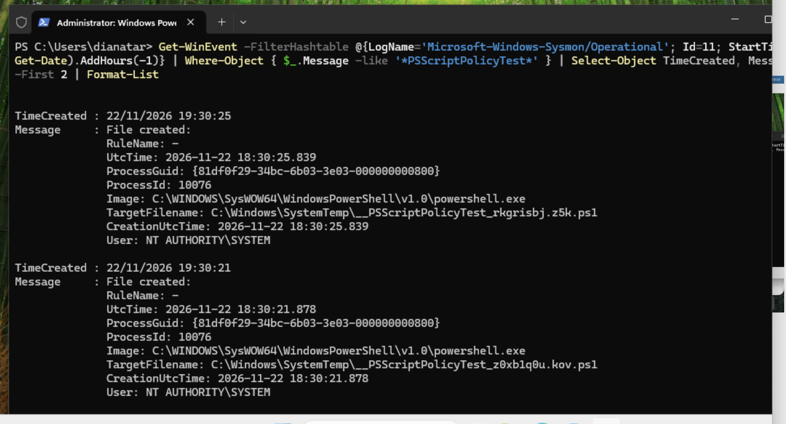

# RULE-100103: <short title>

| Field | Value |
| --- | --- |
| Rule ID / level | 100103 / 0 |
| Based on | 92205 |
| Found in | INC-006, the Wazuh SCA false positive |
| MITRE ATT&CK | none (tuning rule) |

## Problem
The false position in INC-006 revealed that the potential danger was just system checking the rules and creating files (more details in INC-006 report). Therefore, Rule 100103 fixes this overstatement to reduce noise.

## Rule

```xml
<group name="local,windows,sysmon,">
  <rule id="100103" level="0">
    <if_sid>92205</if_sid>
    <field name="win.eventdata.targetFilename" type="pcre2">(?i)\\__PSScriptPolicyTest_[a-z0-9.]+\.ps(m)?1$</field>
    <description>PowerShell execution policy test file - known false positive (INC-006)</description>
  </rule>
</group>
```
The rule is raised whenever whenever Rule 92205 is and checks whether it contains __PSScriptPolicyTest_<random letters>.ps1 (or .psm1) because this is when Rule 92205 is False Positive.

What the rule does, in plain words (1–2 sentences).

## Test
How I tested it:

```powershell
Restart-Service WazuhSvc
```

## Result

| | Before | After |
| --- | --- | --- |
| Rule ID | 92205 | 100103 |
| Level | 9 | 0 |
| Description | Powershell process created an executable file in Windows root folder | PowerShell execution policy test file - known false positive (INC-006) |




## Trade-off
## Trade-off
This rule removes a level 9 false positive that fired on every Wazuh SCA scan, so there is less noise for the analyst. The cost is that the rule only checks the file name, not who created the file. PowerShell creates this test file every time it runs a script, so the alert is silenced for every PowerShell run, not only for SCA. In INC-008 the attacker's PowerShell also created this file and 92205 fired. After this rule that alert is gone, but the attack is still detected by rule 100100 at level 12, so no important detection is lost.

## Limits
An attacker can abuse the name. A malicious script named __PSScriptPolicyTest_abc.ps1 would be silenced too, because the rule only checks the file name.
